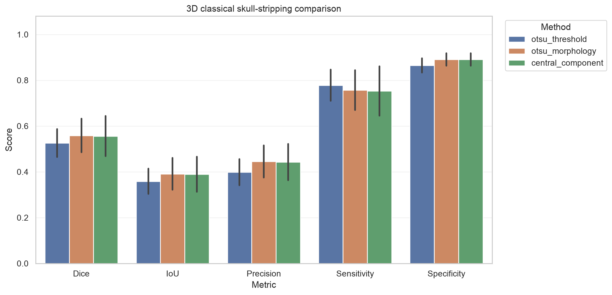
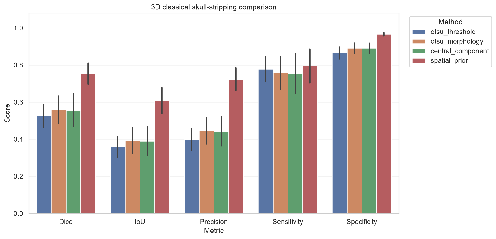

# NFBS External Validation

## Purpose

These experiments test whether the fixed classical baselines transfer beyond the dataset used for parameter selection. A constructed center-slice analysis and a complete-volume analysis are deliberately reported separately from SynthStrip.

## Dataset

The Neurofeedback Skull-stripped (NFBS) repository contains 125 defaced, anonymized T1-weighted MRI volumes and manually corrected brain masks. The source paper states that the repository is completely open and requires neither an application nor a data-usage agreement.

- Project: <https://preprocessed-connectomes-project.org/NFB_skullstripped/>
- Archive: `NFBS_Dataset.tar.gz`, 1,751,464,473 bytes
- Verified SHA-256: `fd616b9ea21aad3d0d4cd05a25a71f4a3c251140df38188e58e499254440d2cc`
- Citation: Puccio et al., *GigaScience* 2016;5:45, <https://doi.org/10.1186/s13742-016-0150-5>

## Leakage controls

1. The SynthStrip morphology, centrality, normalization, warning, and category thresholds were frozen before NFBS evaluation.
2. Each NFBS volume was converted to closest-canonical orientation.
3. The center index of the sagittal image axis was selected using image geometry only.
4. The reference mask was sliced at the same index but never used to select the slice.
5. No setting was changed after inspecting NFBS results.
6. The complete-volume configuration transfers the same scale fractions into 3D and was not tuned on NFBS.
7. NFBS outputs remain separate from SynthStrip outputs.

The center-slice result is a constructed 2D external experiment whose slice-selection procedure may differ from the official SynthStrip archive. The separate complete-volume result has no slice-selection step.

## Reproduction

```bash
python -m scripts.prepare_nfbs_external

python -m src.evaluate \
  --data-dir data/processed/nfbs_2d_external \
  --output-dir outputs/nfbs_external_run \
  --subset test \
  --seed 42

python -m src.evaluate_3d \
  --data-dir data/raw/nfbs_extracted/NFBS_Dataset \
  --output-dir outputs/nfbs_3d_full \
  --seed 42
```

## Constructed 2D results

| Method | N | Mean Dice | Median Dice | Mean IoU | Precision | Sensitivity | HD95 (mm) |
|---|---:|---:|---:|---:|---:|---:|---:|
| `otsu_threshold` | 125 | 0.5056 | 0.5152 | 0.3414 | 0.4497 | 0.5824 | 75.49 |
| `otsu_morphology` | 125 | 0.5252 | 0.5504 | 0.3625 | 0.5043 | 0.5559 | 74.09 |
| `central_component` | 125 | **0.5368** | **0.5955** | **0.3960** | **0.6145** | 0.4999 | **66.51** |

The central-component method improved mean Dice over raw Otsu by 0.0312. Its paired 95% bootstrap interval was 0.0014–0.0602. However, its absolute mean Dice was 0.2535 lower than on SynthStrip, and its range was 0.000–0.888.

## Complete 3D results

| Method | N | Mean Dice | Median Dice | Mean IoU | Precision | Sensitivity | Surface Dice | HD95 (mm) |
|---|---:|---:|---:|---:|---:|---:|---:|---:|
| `otsu_threshold` | 125 | 0.5255 | 0.5272 | 0.3587 | 0.3985 | **0.7780** | 0.1141 | 79.43 |
| `otsu_morphology` | 125 | **0.5589** | **0.5645** | **0.3913** | **0.4452** | 0.7573 | **0.1414** | **77.86** |
| `central_component` | 125 | 0.5559 | **0.5645** | 0.3895 | 0.4429 | 0.7531 | 0.1412 | 77.90 |

Morphology improved mean Dice over Otsu by 0.0334 (paired 95% bootstrap CI 0.0306–0.0360) and won on 121 subjects. Component selection tied morphology on 124 subjects and caused one zero-overlap result, so it did not improve the 3D baseline. Morphology is the measured full-volume winner.



## Constructed 2D failure analysis

For `central_component`:

| Primary retrospective category | Images | Percentage |
|---|---:|---:|
| Under-segmentation | 44 | 35.2% |
| Boundary mismatch | 33 | 26.4% |
| Mixed overlap error | 31 | 24.8% |
| Wrong component selected | 12 | 9.6% |
| Over-segmentation | 5 | 4.0% |

No NFBS result met the strict acceptable category. Representative failures show scalp, neck, or peripheral bright tissue becoming a more plausible connected component than the brain. This is a limitation of intensity grouping and simple centrality—not an implementation result to hide.

## Complete 3D failure analysis

For `otsu_morphology`, 124 of 125 predictions were categorized as over-segmentation and one as boundary mismatch. The best subjects were `A00057786` (Dice 0.706), `A00054019` (0.701), and `A00054441` (0.684); even these retained excess non-brain tissue. The worst were `A00060006` (0.267), `A00063368` (0.372), and `A00051539` (0.387). Orthogonal review figures show the threshold retaining scalp, face, and neck tissue. Component selection made `A00063368` a zero-overlap prediction.

## Exploratory follow-up after NFBS inspection

The initial NFBS results motivated a fourth method that constrains the morphology mask with a superior central ellipsoid and performs cleanup in physical units. Because this design responds to errors already seen on NFBS, its result is not part of the untouched external validation above.

| Method | Mean Dice | Precision | Sensitivity | Surface Dice | HD95 (mm) |
|---|---:|---:|---:|---:|---:|
| `otsu_morphology` | 0.5589 | 0.4452 | 0.7573 | 0.1414 | 77.86 |
| `spatial_prior` | **0.7537** | **0.7238** | **0.7947** | **0.2160** | **21.94** |

The exploratory method improved Dice by 0.1948 (paired 95% bootstrap CI 0.1879–0.2018) and won on all 125 subjects. Its Dice range was 0.515–0.876, and only 21 cases met the strict acceptable category. This supports spatial restriction as a useful hypothesis while leaving transfer to a new dataset unanswered.



## Interpretation

In the constructed 2D result, morphology and central-component selection improve the average. In complete 3D, morphology improves on Otsu but component selection adds no benefit. Their absolute accuracy remains poor: the 3D morphology result combines 0.445 precision with 0.757 sensitivity, and 124 of 125 masks are categorized as over-segmentation. One external T1 dataset cannot establish universal failure, but it is enough to reject the claim that the SynthStrip score generalizes automatically or that full-volume thresholding solves the problem.

The next experiment should reserve an untouched external dataset before adapting the spatial prior or selecting a learned model. This remains educational research, not clinical validation.
