# Project Report

## Objective

Evaluate three understandable classical image-processing baselines for brain MRI skull stripping before attempting deep learning. The research question is whether morphology and anatomical location heuristics improve a simple intensity threshold across varied 2D scans and complete 3D volumes.

## Dataset

The experiment uses the official SynthStrip 2D dataset, version 1.5. It contains one sagittal NIfTI slice and one binary brain mask for each scan. The authors provide a scan-level split: 24 validation scans and 558 test scans. This project uses validation as development and reports final results once on all 558 test scans.

The archive SHA-256 matched the official value before extraction. All 582 image-mask pairs loaded successfully, had matching spatial dimensions, and used binary masks. No test pair was skipped. IXI content is CC BY-SA 4.0; other redistributed content is CC BY 4.0. See the dataset README and the citation in the project README.

External validation uses the open NFBS repository: 125 defaced, anonymized T1 volumes with manually corrected brain masks. The 1,751,464,473-byte archive matched the project-pinned SHA-256 `fd616b9ea21aad3d0d4cd05a25a71f4a3c251140df38188e58e499254440d2cc`. Each volume was reoriented to closest canonical coordinates and its center sagittal slice was selected from image geometry alone. No NFBS mask influenced slice selection, parameter selection, or tuning.

The same verified NFBS files also support a complete-volume experiment. All 125 image-mask pairs had matching 3D shapes, canonical affines, and valid physical voxel spacing; none was skipped. This experiment uses the entire volume rather than selecting one slice.

## Methods

All images were clipped at their per-image 1st and 99th intensity percentiles and scaled to `[0, 1]`.

1. `otsu_threshold` applies Otsu's two-class threshold and chooses bright or dark polarity with a deterministic center/area/border score.
2. `otsu_morphology` adds opening, closing, hole filling, and scale-aware small-object removal.
3. `central_component` adds a deterministic area-and-centrality component score, retains one component, fills holes, and performs final closing.

The 3D implementation preserves these stable method names but uses spherical structuring elements, 26-neighbor connected components, scale-aware volume thresholds, and full 3D surfaces. No method uses the reference mask during prediction.

No ground-truth mask is used during prediction. No method learns from the test set.

The evaluator also records surface Dice at one-pixel tolerance plus HD95 and ASSD in both pixels and physical millimeters read from the NIfTI header. Reference-free checks measure predicted area, connected components, centroid location, border contact, and disagreement among methods to flag masks for review.

A separate retrospective taxonomy uses the reference-derived metrics after evaluation. It labels dominant outcomes such as under-segmentation, over-segmentation, boundary mismatch, fragmentation, border leakage, likely polarity failure, and wrong-component selection. These labels explain known results; they are not deploy-time confidence predictions.

## Experimental design

A grid of 81 parameter combinations was evaluated on only the 24 development scans. The chosen configuration used opening fraction 0.008, closing fraction 0.004, minimum component area fraction 0.005, and centrality weight 0.75. On development data, Method 2 reached mean Dice 0.744 and Method 3 reached 0.750.

The warning thresholds were separately audited on the same 24 development scans. For a predefined failure threshold of Dice below 0.40, a small grid recommended the existing defaults and identified both development failures with no false warning. This tiny calibration result is not a general accuracy claim.

The final CLI then evaluated the fixed configuration on 558 held-out test scans using seed 42. Metrics were calculated per image, then summarized across images. Confidence intervals and paired method differences used 1,000 scan-level bootstrap resamples with the same seed. Paired Wilcoxon tests used Holm correction across reported comparisons. Processing time covers segmentation only. The complete configuration and package versions are in `outputs/full_run/run_config.json`.

The exact same configuration was then frozen and run once on all 125 NFBS subjects. NFBS was not used to choose thresholds, morphology radii, centrality weight, warning rules, or failure-category thresholds.

For complete-volume evaluation, the 2D fractions were transferred directly to 3D dimensions and recorded in `configs/volume_default.yaml`; no NFBS result was used to search for better values. Each subject remained one independent evaluation unit. Bootstrap intervals and paired tests therefore resampled subjects, not voxels.

## Results

| Method | N | Dice mean (median) | IoU mean | Precision | Sensitivity | Specificity | Mean time |
|---|---:|---:|---:|---:|---:|---:|---:|
| `otsu_threshold` | 558 | 0.749 (0.764) | 0.618 | 0.681 | 0.884 | 0.765 | 0.00034 s |
| `otsu_morphology` | 558 | 0.772 (0.787) | 0.650 | 0.709 | **0.904** | 0.786 | 0.00225 s |
| `central_component` | 558 | **0.790 (0.823)** | **0.678** | **0.749** | 0.901 | **0.817** | 0.00397 s |

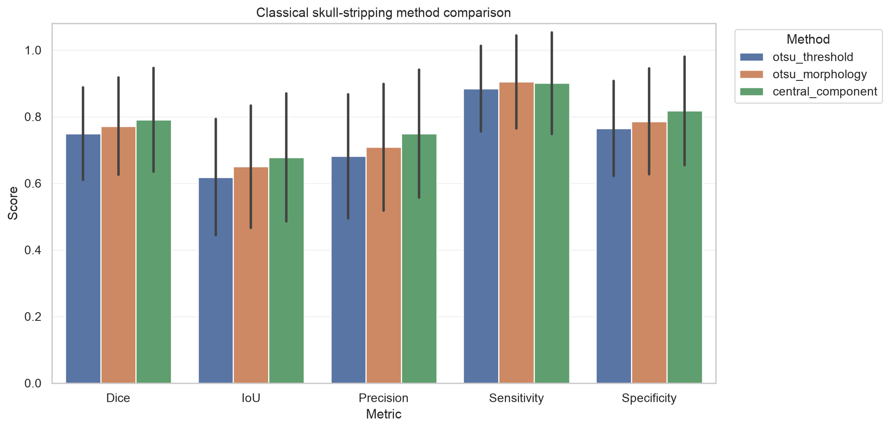

The methods improve progressively in mean Dice, IoU, precision, and specificity. Method 2 has slightly higher mean sensitivity than Method 3 because component selection can discard true disconnected brain pixels. Method 3's extra precision and specificity produce the best overall overlap.

| Method | Mean Dice 95% CI | Surface Dice | HD95 (mm) | ASSD (mm) |
|---|---:|---:|---:|---:|
| `otsu_threshold` | 0.737–0.761 | 0.278 | 53.09 | 16.36 |
| `otsu_morphology` | 0.759–0.783 | 0.307 | 46.90 | 14.25 |
| `central_component` | **0.777–0.803** | **0.333** | **43.88** | **13.26** |

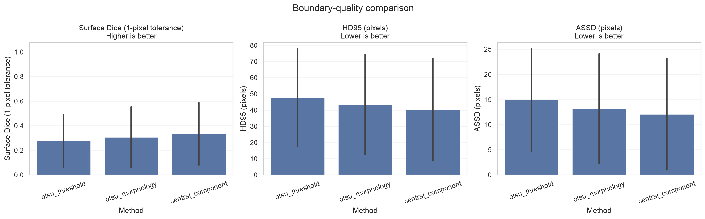

## Paired improvements

Every method processed the same scans, so the analysis subtracts scores scan by scan. Morphology minus Otsu improved Dice by 0.0223 on average (95% bootstrap CI 0.0196–0.0251), winning on 449 scans and losing on 108. Central component minus Otsu improved Dice by 0.0409 (0.0355–0.0468), winning on 456 scans and losing on 101. Central component minus morphology improved Dice by 0.0187 (0.0150–0.0228), with 302 wins, 21 losses, and 235 ties. All Dice comparisons remained significant after Holm correction, but the effect sizes and failures matter more than a small p-value.

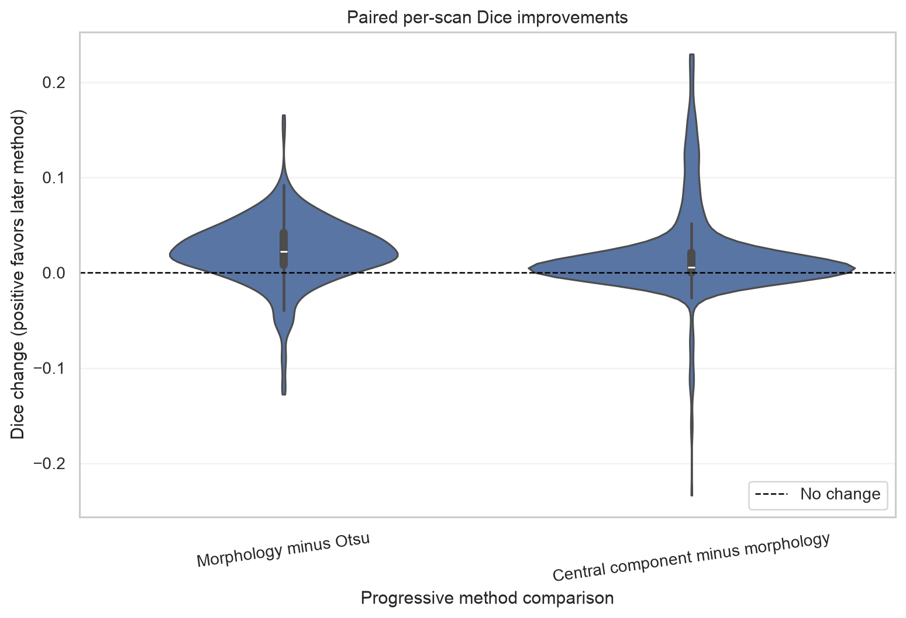

## Reliability warnings

The `central_component` checks flagged 31 of 558 predictions. Flagged predictions had mean Dice 0.551; unflagged predictions had mean Dice 0.804. All four cases below 0.20 Dice and 12 of 13 below 0.40 were flagged, largely through method disagreement. Only 17 of 50 cases below 0.60 were flagged, so this is a conservative review mechanism rather than a guarantee.

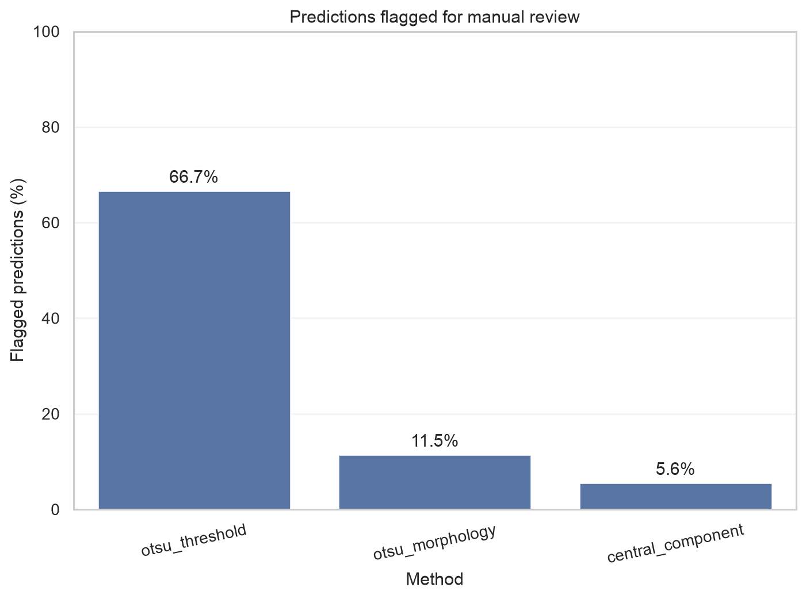

## Retrospective failure taxonomy

For `central_component` on SynthStrip, the primary categories were 273 over-segmentations, 221 acceptable cases, 37 under-segmentations, nine mixed errors, eight boundary mismatches, eight wrong-component selections, and two border leakages. The strict acceptable category requires Dice at least 0.80 and no dominant error reason.

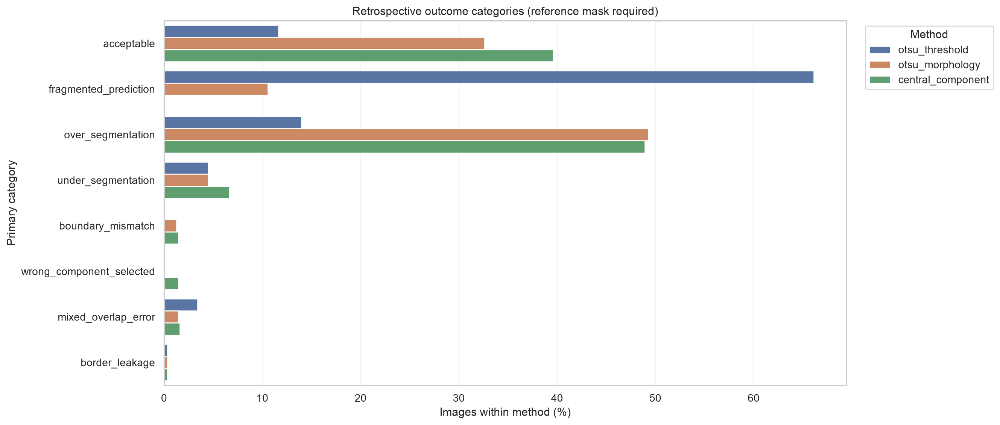

## External NFBS evaluation

| Method | N | Dice mean (median) | IoU mean | Precision | Sensitivity | HD95 (mm) |
|---|---:|---:|---:|---:|---:|---:|
| `otsu_threshold` | 125 | 0.506 (0.515) | 0.341 | 0.450 | **0.582** | 75.49 |
| `otsu_morphology` | 125 | 0.525 (0.550) | 0.362 | 0.504 | 0.556 | 74.09 |
| `central_component` | 125 | **0.537 (0.596)** | **0.396** | **0.615** | 0.500 | **66.51** |

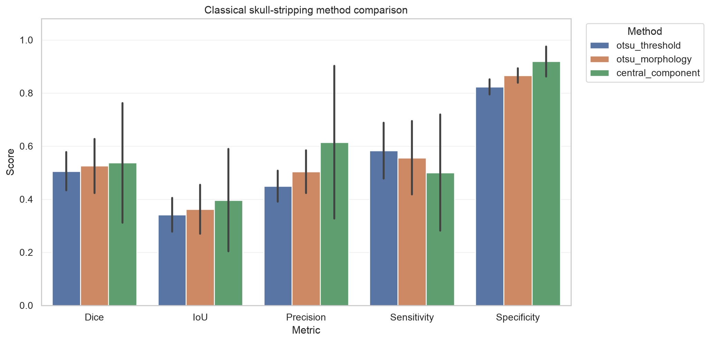

The central-component method still had the best mean overlap, but its mean Dice dropped by 0.2535 relative to SynthStrip. Its NFBS standard deviation was 0.2257 and its range was 0.000–0.888. The external taxonomy found 44 under-segmentations, 33 boundary mismatches, 31 mixed errors, 12 wrong-component selections, and five over-segmentations. No prediction met the strict acceptable rule.

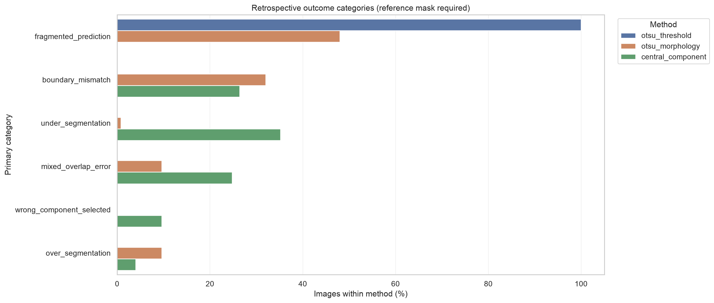

## Complete 3D NFBS evaluation

| Method | N | Dice mean (median) | IoU mean | Precision | Sensitivity | Specificity | Surface Dice | HD95 (mm) |
|---|---:|---:|---:|---:|---:|---:|---:|---:|
| `otsu_threshold` | 125 | 0.526 (0.527) | 0.359 | 0.399 | **0.778** | 0.865 | 0.114 | 79.43 |
| `otsu_morphology` | 125 | **0.559 (0.565)** | **0.391** | **0.445** | 0.757 | 0.891 | **0.141** | **77.86** |
| `central_component` | 125 | 0.556 (0.565) | 0.390 | 0.443 | 0.753 | **0.891** | 0.141 | 77.90 |

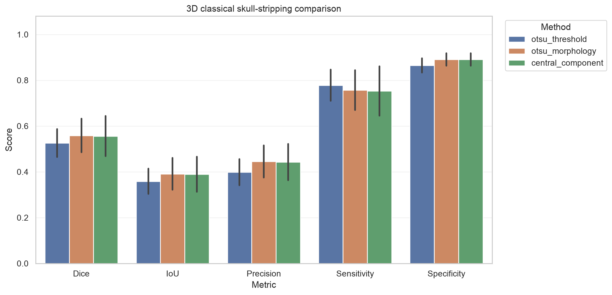

Morphology improved mean Dice over Otsu by 0.0334 (95% paired bootstrap CI 0.0306–0.0360), with 121 wins and four losses. Its mean Dice 95% interval was 0.5461–0.5719. The central-component step tied morphology on 124 subjects and harmed one, producing a mean difference of -0.0030 (95% CI -0.0089–0.0000; Holm-adjusted p=1.0). The complete-volume winner is therefore `otsu_morphology`.

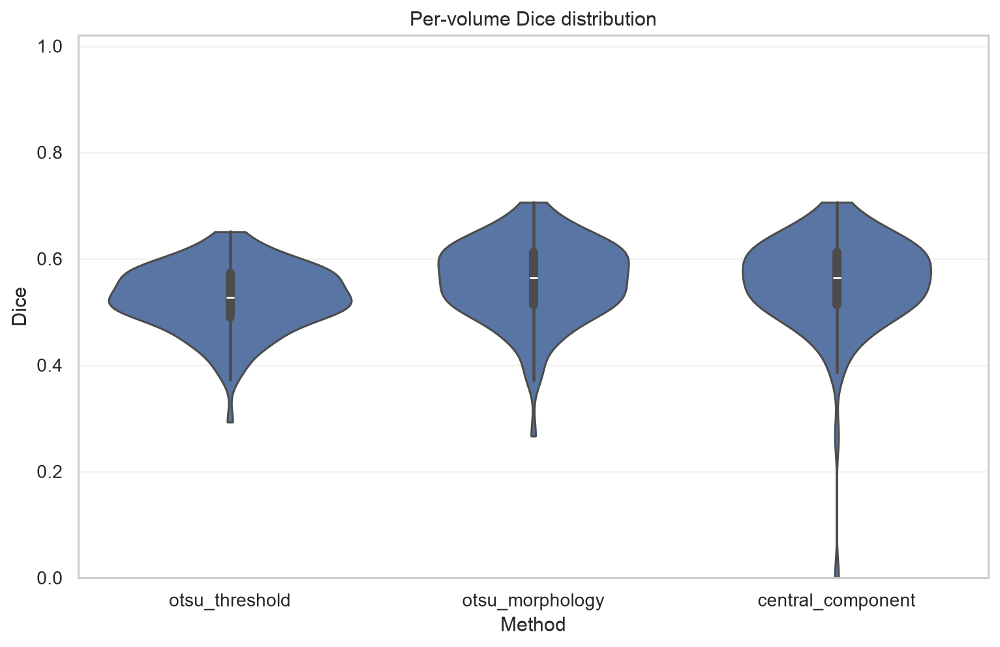

The absolute result remains weak. Morphology averaged 0.445 precision and 0.757 sensitivity, consistent with keeping large amounts of scalp, face, and neck tissue. The retrospective taxonomy classified 124 morphology predictions as over-segmentation and one as boundary mismatch. Full 3D context alone did not solve the anatomical ambiguity of intensity thresholding.

## Exploratory spatial-prior follow-up

After the full-volume NFBS failures were inspected, an optional fourth method was added. `spatial_prior` intersects the unchanged morphology result with a configurable ellipsoid in closest-canonical RAS coordinates, removes the inferior neck region, and performs final morphology using millimetre radii and a millilitre component threshold. Because NFBS informed the problem choice, this is a second-look exploratory analysis rather than independent external validation.

| Method | N | Dice mean (median) | IoU | Precision | Sensitivity | Specificity | Surface Dice | HD95 (mm) |
|---|---:|---:|---:|---:|---:|---:|---:|---:|
| `otsu_morphology` | 125 | 0.559 (0.565) | 0.391 | 0.445 | 0.757 | 0.891 | 0.141 | 77.86 |
| `spatial_prior` | 125 | **0.754 (0.756)** | **0.608** | **0.724** | **0.795** | **0.966** | **0.216** | **21.94** |

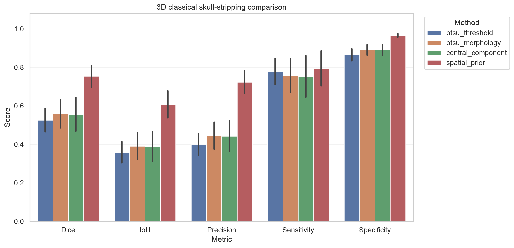

Spatial restriction improved Dice over morphology by 0.1948 (paired 95% bootstrap CI 0.1879–0.2018), winning on all 125 subjects. Mean Dice for the new method had a 95% bootstrap interval of 0.7437–0.7635. Mean ASSD fell from 19.01 mm to 7.62 mm.

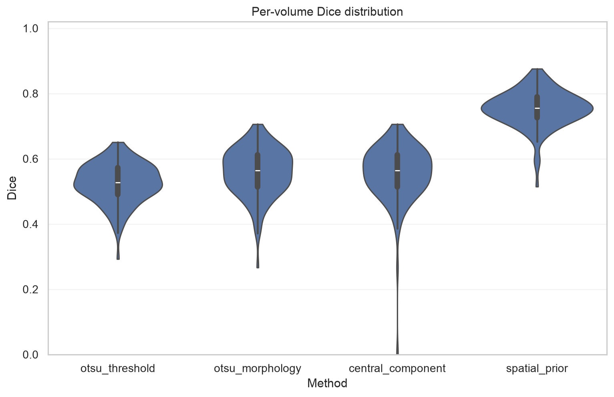

The improvement is substantial but incomplete. Dice ranged from 0.515 to 0.876. The retrospective categories were 46 boundary mismatches, 29 over-segmentations, 24 mixed errors, 21 acceptable cases, and five under-segmentations. These errors show the tradeoff of a fixed geometric prior: it removes peripheral false positives but can also clip real brain or preserve non-brain tissue within the ellipsoid.

## Successful cases

- `ixi_mra_138`: Dice 0.989, IoU 0.977. Prediction closely follows the reference with only a thin boundary error.
- `asl_epi_124`: Dice 0.983, IoU 0.968. The low-resolution brain is a dominant compact component, so cleanup is reliable.
- `ixi_mra_013`: Dice 0.979, IoU 0.958. Strong foreground separation and a central connected region suit the heuristic.

These cases show why the later methods help: morphology removes fragments, while component selection rejects competing peripheral regions.

## Failure cases

- `ixi_t2_022`: Dice 0.085, IoU 0.045. The method retains a bright internal structure. Precision is 1.000, but sensitivity is only 0.045, so almost all true brain tissue is absent.
- `ixi_t2_141`: Dice 0.096, IoU 0.050. Bright scalp/skull and cortical edges compete with the heterogeneous brain, creating both false positives and extensive false negatives.
- `ixi_t2_020`: Dice 0.132, IoU 0.070. A small bright central structure wins the component score even though it is not the whole brain.

These failures explain why the later method is not uniformly better. Selecting one component helps when non-brain clutter is separate, but hurts when thresholding fragments the actual brain or a wrong central structure looks most plausible.

The complete 3D review reaches the same conclusion from whole volumes. The best morphology cases were `A00057786` (Dice 0.706), `A00054019` (0.701), and `A00054441` (0.684). Even these were categorized as over-segmentation. The worst were `A00060006` (0.267), `A00063368` (0.372), and `A00051539` (0.387), where scalp, face, and neck survived the threshold. On `A00063368`, component selection discarded the morphology result and produced zero overlap, showing that a plausible central-component heuristic can make a complete-volume prediction worse.

For the exploratory spatial prior, the best cases were `A00054019` (Dice 0.876), `A00050940` (0.865), and `A00054441` (0.856). The worst were `A00060006` (0.515), `A00040623` (0.579), and `A00051539` (0.599). The worst review still shows both missed brain and retained scalp, demonstrating that the ellipsoid is a coarse restriction rather than anatomical understanding.

## Interpretation

The internal experiment supports a narrow conclusion: on the SynthStrip 2D test split, deterministic cleanup and component selection improve average overlap over raw Otsu. The initial NFBS results show that the absolute performance does not transfer reliably to a different T1 acquisition and field of view. Processing the entire 3D volume alone was insufficient. The exploratory follow-up supports a more specific hypothesis: much of the NFBS error came from anatomically implausible inferior and peripheral foreground. It does not establish how the fixed prior will transfer to new data. None of these results shows that thresholding is clinically adequate.

Performance varies by source group for Method 3: ASL 0.851, QIN 0.852, IXI 0.799, Infant 0.714, and FSM 0.700 mean Dice. It also varies by modality encoded in the identifiers: ASL/EPI 0.952, MRA 0.947, DWI 0.912, FLAIR 0.904, T2 0.775, PD 0.757, T1 0.755, and qT1 0.514. MRI contrast, resolution, anatomy, and acquisition differences challenge a single intensity rule.

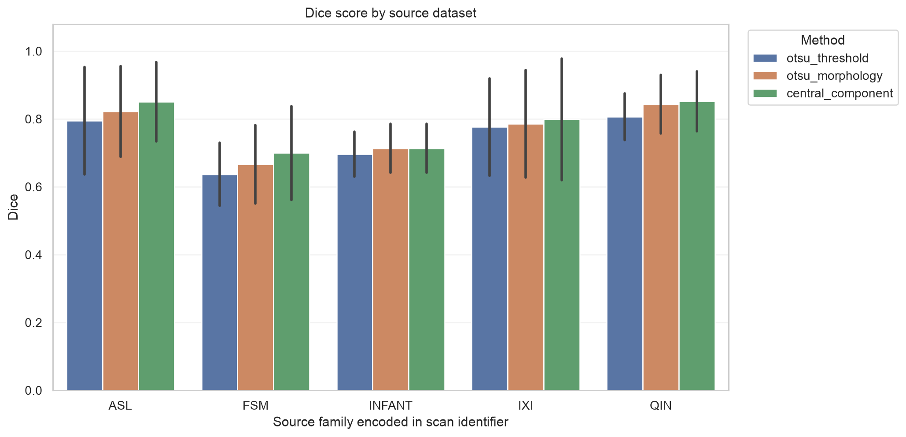

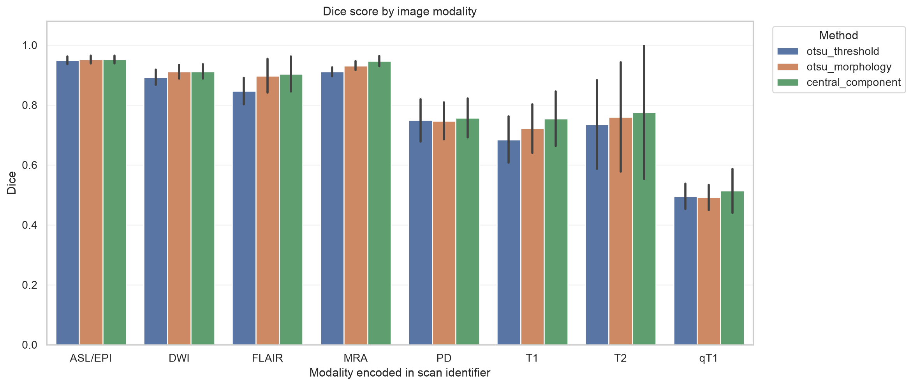

## Limitations

- The main SynthStrip benchmark contains only one sagittal slice per scan. Complete-volume evidence comes from one external T1 dataset.
- Only 24 scans informed parameter choice.
- The heuristic encodes assumptions about intensity, size, connectivity, and location.
- The exploratory spatial prior was motivated after NFBS inspection and assumes typical anatomy in closest-canonical coordinates. Its 0.754 Dice is not an unbiased external-validation estimate.
- Warning thresholds were calibrated on only 24 development scans. They remain geometry heuristics rather than confidence probabilities and miss some poor predictions.
- Millimeter boundary distances depend on NIfTI header spacing. The SynthStrip and constructed NFBS results measure 2D contours; the full NFBS experiment measures 3D surfaces.
- Results may not transfer to another scanner, protocol, population, or mask definition.
- The constructed NFBS slice experiment differs from SynthStrip's published 2D slice construction. The complete NFBS experiment avoids that limitation but strongly over-segments adjacent anatomy.
- Timing is specific to the local Apple-silicon software environment.
- This is not a prospective, clinical, diagnostic, or regulatory evaluation.

## Proposed next experiment

Reserve a new external dataset before changing the spatial method further. On declared development data, replace the fixed ellipsoid with adaptive head localization, bias-field correction, atlas initialization, or watershed/graph-cut refinement and perform an ablation of each operation. A later small U-Net should use a leakage-safe subject-level design and the untouched external dataset. The question is whether learned spatial features improve the remaining boundary errors without relying on an acquisition-specific geometric prior.

