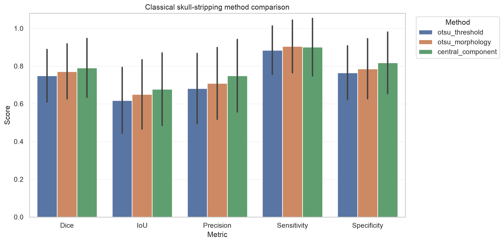
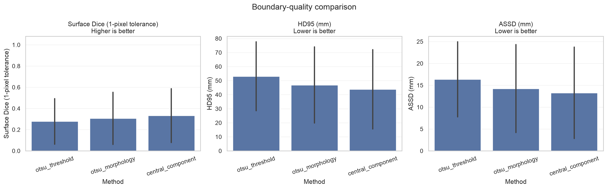
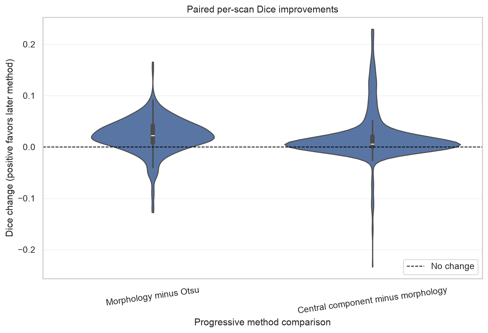
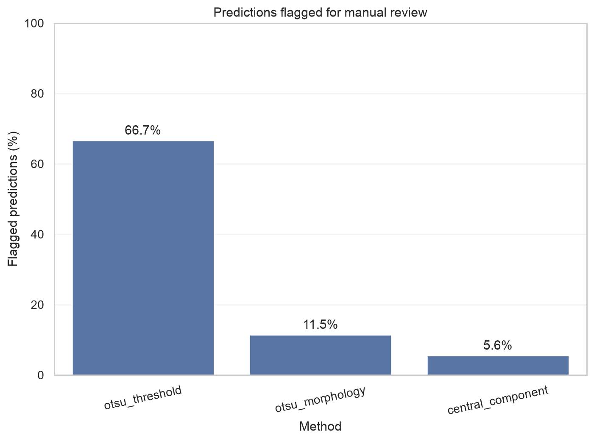
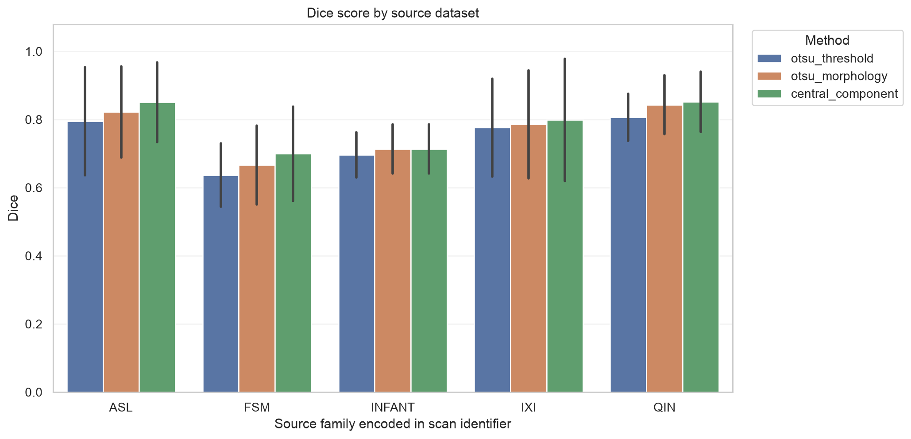
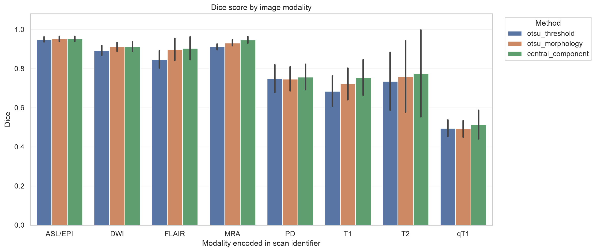

# Brain MRI Skull-Stripping Evaluator: Classical Image Processing Baselines

An educational, beginner-friendly research prototype that asks a simple question:

> How far can understandable classical image-processing methods go when separating brain tissue from non-brain pixels in varied 2D medical images?

This project evaluates three fixed baselines on the official SynthStrip 2D v1.5 dataset. It does **not** use deep learning, train a model, or provide medical advice.

## What the project does

For each 2D image, the program loads its reference brain mask, robustly normalizes image intensity, runs three methods, measures their predictions, and writes tables and figures:

1. `otsu_threshold`: one automatically selected threshold, with deterministic polarity handling.
2. `otsu_morphology`: Otsu plus opening, closing, hole filling, and small-object removal.
3. `central_component`: Method 2 plus a deterministic largest-central-component heuristic and final cleanup.

The implementation is separated into dataset loading, preprocessing, segmentation, metrics, evaluation, and visualization modules. There is no notebook-only logic and no hidden metrics library.

The evaluator also calculates boundary metrics in pixels and physical millimeters, stratifies results by source dataset and MRI modality, performs paired scan-level comparisons, produces deterministic bootstrap confidence intervals, and applies reference-free geometry checks that flag suspicious masks for manual review.

## Why skull stripping matters

Brain MRI is an imaging technique that uses magnetic fields and radio waves to show soft tissue. A **pixel** is one number at one location in a 2D image; a **voxel** is its 3D equivalent. A scan can include brain tissue, skull, skin, eyes, neck, empty background, and scanner artifacts.

**Segmentation** assigns pixels to categories. **Skull stripping** is a binary segmentation task: keep the brain and reject everything else. A clean brain mask can simplify later measurement, registration, visualization, or disease-research pipelines. A bad mask can remove real brain tissue or keep distracting non-brain anatomy, so its errors must be measured.

An **image** stores intensity values. A **mask** stores labels aligned to the image: here, `1` means reference brain and `0` means non-brain.

## Methods in plain language

### Intensity normalization

MRI intensity has no universal brightness scale. For each image, this project clips values to its 1st and 99th percentiles and scales the result to `[0, 1]`. Percentile clipping stops a few extreme values from controlling the scale. A constant image becomes all zeros and is handled safely.

### Otsu thresholding

Otsu's method examines the intensity histogram and selects the threshold that best separates two intensity groups. Pixels on one side become foreground. Brain tissue is not always the brighter group, so the code scores both polarities using center coverage, border contact, and a broad plausible-area preference. It never consults the ground-truth mask to choose polarity.

Limitation: a histogram knows brightness, not anatomy. Skull, fluid, or internal structures can share the selected intensity range.

### Morphological cleanup

Morphology changes shapes using a small neighborhood called a structuring element:

- **Erosion** shrinks foreground and can remove thin protrusions.
- **Dilation** expands foreground and can bridge small gaps.
- **Opening** is erosion followed by dilation; it removes isolated foreground noise while approximately restoring larger regions.
- **Closing** is dilation followed by erosion; it connects nearby regions and closes narrow gaps.
- **Hole filling** fills enclosed background pockets.
- **Small-object removal** removes connected regions below a scale-aware area threshold.

Radii and minimum area are fractions of the real image dimensions, not assumptions about a 256×256 image.

### Connected components

A connected component is a group of touching foreground pixels. The third method scores each component as:

`area × (1 + centrality_weight × centrality)`

Centrality is 1 at the image center and falls toward the corners. Area remains important, but similarly sized central anatomy is preferred over a peripheral artifact. Exact ties are resolved by label order, so the result is deterministic. This is still a heuristic: the brain may not be centered, and a bright central structure may not represent the whole brain.

### Prediction-quality warnings

The evaluator measures predicted area, component count, largest-component fraction, centroid distance, border contact, and disagreement among the three methods. Configurable rules in `configs/default.yaml` flag unusual predictions. These checks do not read the reference mask, so they can identify results that deserve inspection even when ground truth is unavailable.

A warning means “review this mask,” not “this mask is definitely wrong.” A plausible-looking mask can still be inaccurate, and a valid unusual scan can still trigger a warning.

## Metrics

For a predicted mask and reference mask:

- **True positive (TP):** correctly predicted brain pixel.
- **True negative (TN):** correctly rejected non-brain pixel.
- **False positive (FP):** non-brain pixel incorrectly kept.
- **False negative (FN):** brain pixel incorrectly removed.

The formulas implemented in `src/metrics.py` are:

- Dice = `2TP / (2TP + FP + FN)`
- IoU = `TP / (TP + FP + FN)`
- Precision = `TP / (TP + FP)`
- Sensitivity/recall = `TP / (TP + FN)`
- Specificity = `TN / (TN + FP)`

Three boundary metrics complement region overlap:

- **Surface Dice** measures how many boundary pixels lie within one pixel of the other boundary. Higher is better.
- **HD95** is the 95th percentile of symmetric boundary distances. Lower is better.
- **ASSD** is the average symmetric surface distance. Lower is better.

HD95 and ASSD are reported both in pixels and in millimeters. The loader reads the row and column spacing stored in each NIfTI header, so physical distances respect mixed native resolutions. When exactly one mask is empty, the corresponding image diagonal is used as an explicit finite distance penalty.

Dice and IoU measure overlap. Precision asks, “of what I called brain, how much was correct?” Sensitivity asks, “of the real brain, how much did I find?” Specificity asks, “of the non-brain background, how much did I reject?” Pixel accuracy is recorded but is not a headline result because a large background can make a poor brain mask look deceptively accurate.

For two empty masks, Dice and IoU equal 1 because the masks agree perfectly. If a denominator contains no relevant positives, the metric is 1 only when no corresponding error was made. Every convention is tested in `tests/test_metrics.py`.

## Dataset, license, and citation

The project uses the [official SynthStrip dataset page](https://surfer.nmr.mgh.harvard.edu/docs/synthstrip/) and the 39 MB `synthstrip_data_v1.5_2d.tar` archive. Version 1.5 was released on 2024-06-20. Its official SHA-256 is:

```text
69b3c3d9e37ef63b800137e25386f0cfb6851803916900923af1cedd4e0d55f4
```

The archive contains one sagittal slice per scan, stored as `image.nii.gz` and `mask.nii.gz`. The official scan lists provide 24 validation scans and 558 test scans. This project calls validation **development**, uses it to select morphology parameters, and reports final comparisons on the untouched 558-scan test split. Because each 2D item comes from a different scan, the division is scan-level and related slices cannot cross splits.

According to the included dataset README, IXI images use [CC BY-SA 4.0](https://creativecommons.org/licenses/by-sa/4.0/) and the other redistributed SynthStrip content uses [CC BY 4.0](https://creativecommons.org/licenses/by/4.0/). Original-source citations are listed in `data/processed/synthstrip_data_v1.5_2d/README.txt` after download.

Please cite:

> Hoopes A, Mora JS, Dalca AV, Fischl B, Hoffmann M. SynthStrip: Skull-Stripping for Any Brain Image. *NeuroImage*. 2022;260:119474. [doi:10.1016/j.neuroimage.2022.119474](https://doi.org/10.1016/j.neuroimage.2022.119474)

Dataset files are excluded from Git. Do not add private or clinical scans to this repository.

## Installation on Apple silicon macOS

Python 3.11 or newer is supported. The verified run used Python 3.13.15 on Apple silicon.

```bash
cd brain-mri-skull-stripping-evaluator
python3 -m venv .venv
source .venv/bin/activate
python -m pip install --upgrade pip
python -m pip install -r requirements.txt
```

The dependencies have native Apple-silicon wheels and do not include PyTorch, TensorFlow, MONAI, or another deep-learning framework.

## Download and verify the official data

```bash
python -m scripts.download_data
```

The script downloads only the official MGH URL, calculates SHA-256, checks that the file is a tar archive, rejects unsafe archive paths/links, and extracts without modifying source files. The resulting data directory is:

```text
data/processed/synthstrip_data_v1.5_2d
```

## Run tests

```bash
python -m pytest -q
```

Verified result: `38 passed`.

For the complete development checks used in this repository:

```bash
python -m pip install -r requirements-dev.txt
ruff check .
mypy src
python -m pytest -q --cov=src --cov-report=term-missing
```

The verified branch coverage was 57.3%, above the explicit 55% project floor. The test suite includes a subprocess integration test that creates a temporary NIfTI dataset and exercises the complete CLI.

## Reproduce development tuning

This optional command evaluates 81 small morphology configurations on only the 24 official development scans:

```bash
python -m scripts.tune_on_development \
  --data-dir data/processed/synthstrip_data_v1.5_2d \
  --output outputs/development_tuning.csv \
  --seed 42
```

The chosen values are recorded in `configs/default.yaml`: opening fraction `0.008`, closing fraction `0.004`, minimum-component area fraction `0.005`, and centrality weight `0.75`. Several centrality weights tied on development data; `0.75` keeps a moderate preference.

## Quick run

This verified command samples 20 test scans deterministically:

```bash
python -m src.evaluate \
  --data-dir data/processed/synthstrip_data_v1.5_2d \
  --output-dir outputs/quick_run \
  --subset test \
  --limit 20 \
  --seed 42
```

## Full evaluation

```bash
python -m src.evaluate \
  --data-dir data/processed/synthstrip_data_v1.5_2d \
  --output-dir outputs/full_run \
  --subset test \
  --seed 42
```

On a system where Matplotlib cannot write its normal user cache, prefix either evaluation command with `MPLCONFIGDIR=outputs/.matplotlib`. This affects only plot caching, not results.

The CLI also accepts overrides such as `--opening-radius-fraction`, `--closing-radius-fraction`, `--minimum-component-area-fraction`, `--centrality-weight`, normalization percentiles, `--boundary-tolerance-pixels`, and `--bootstrap-samples`. Do not tune segmentation parameters on the held-out test metrics.

## Optional local Streamlit explorer

After the command-line pipeline is working, install the separate UI dependency and start the public-dataset explorer:

```bash
python -m pip install -r requirements-app.txt
streamlit run streamlit_app.py
```

The app lets you choose an included official dataset image, adjust morphology settings, compare predictions, view error maps, and inspect Dice/IoU and warning diagnostics. It deliberately has no arbitrary upload control, so it does not invite users to place private patient data in the prototype. The CLI remains the reproducible source of the reported results.

## Calibrate warning rules on development data

The warning thresholds can be audited without touching the test split:

```bash
python -m scripts.calibrate_quality_warnings \
  --data-dir data/processed/synthstrip_data_v1.5_2d \
  --output-dir outputs/quality_calibration \
  --failure-dice-threshold 0.40 \
  --seed 42
```

On the 24 development scans, the search recommended the existing defaults (`minimum_area_fraction=0.03`, `maximum_method_disagreement=0.35`): it identified both development cases below Dice 0.40 with no false warning. That tiny result is a development calibration check, not evidence of general warning accuracy.

## Output directory

Each run writes:

```text
per_image_metrics.csv          one row per scan and method
summary_metrics.csv            aggregate statistics per method
source_summary_metrics.csv     metrics grouped by source family and method
modality_summary_metrics.csv   metrics grouped by encoded MRI modality and method
bootstrap_confidence_intervals.csv  deterministic 95% intervals for mean metrics
paired_method_comparisons.csv  paired improvements, confidence intervals, wins, and tests
quality_summary.csv            warning rates and warning-type counts
run_config.json                seed, parameters, versions, platform, and counts
invalid_pairs.csv              only when invalid inputs are found
method_comparison.png
dice_distribution.png
iou_distribution.png
processing_time_comparison.png
source_dice_comparison.png
modality_dice_comparison.png
paired_dice_improvement.png
quality_warning_rates.png
boundary_metric_comparison.png
best_cases.png
worst_cases.png
overlays/                      six individual five-panel case figures
failure_review.md              ranked prediction-only review queue
failure_review_cases/          multi-method review figures for flagged cases
```

Every case figure shows the normalized MRI, ground truth, prediction, contour overlay, and labeled error map. Error maps use both color and text: TP = correct brain, FP = predicted outside the reference, and FN = missed brain.

Generated data and outputs are intentionally ignored by Git; rerun the commands to reproduce them.

Selected aggregate charts are tracked in `docs/assets/` so they render on GitHub without publishing dataset images.

## Measured held-out results

These are real measurements from the verified full run on all **558 official test scans**, not synthetic examples. Values are per-image means; timing is the mean segmentation time measured on this machine and excludes file loading/plotting.

| Method | Mean Dice | Mean IoU | Precision | Sensitivity | Specificity | Mean time/image |
|---|---:|---:|---:|---:|---:|---:|
| `otsu_threshold` | 0.7494 | 0.6184 | 0.6811 | 0.8843 | 0.7649 | 0.00034 s |
| `otsu_morphology` | 0.7717 | 0.6499 | 0.7087 | 0.9044 | 0.7858 | 0.00225 s |
| `central_component` | **0.7903** | **0.6777** | **0.7491** | 0.9010 | **0.8174** | 0.00397 s |

`central_component` had the best mean Dice and IoU. It improved mean Dice by about 0.041 over raw Otsu. Its median Dice was 0.823, but its minimum was only 0.085; the mean alone hides severe failures.

Quick-run measurements on the deterministic 20-scan sample were Dice 0.7700, 0.7995, and 0.8236. These are a convenience check, not the headline comparison.



### Confidence intervals and boundary quality

The 95% scan-level bootstrap intervals used 1,000 resamples with seed 42:

| Method | Mean Dice (95% CI) | Surface Dice | HD95 (mm) | ASSD (mm) |
|---|---:|---:|---:|---:|
| `otsu_threshold` | 0.7494 (0.7375–0.7609) | 0.2783 | 53.09 | 16.36 |
| `otsu_morphology` | 0.7717 (0.7590–0.7832) | 0.3068 | 46.90 | 14.25 |
| `central_component` | **0.7903 (0.7768–0.8032)** | **0.3332** | **43.88** | **13.26** |



### Paired scan-level comparisons

Because every method processes the same 558 scans, paired differences are more informative than comparing independent means. Morphology improved Dice over Otsu by 0.0223 on average (95% bootstrap CI 0.0196–0.0251) and won on 449 scans. The central-component method improved Dice over Otsu by 0.0409 (0.0355–0.0468) and won on 456 scans. It improved over morphology by 0.0187 (0.0150–0.0228), although 235 scans tied because component selection made no change. Wilcoxon signed-rank tests remained significant after Holm correction; statistical significance does not imply clinical adequacy.



### Reference-free warning results

For `central_component`, 31 of 558 predictions (5.6%) were flagged. Their observed mean Dice was 0.551, compared with 0.804 for unflagged predictions. The rules caught all 4 cases below Dice 0.20 and 12 of 13 below 0.40, but only 17 of 50 below 0.60. They are conservative failure warnings, not a complete error detector or calibrated probability.



### Source-specific results

`central_component` mean Dice varied by source family: ASL 0.851, FSM 0.700, Infant 0.714, IXI 0.799, and QIN 0.852.



### Modality-specific results

The scan identifiers encode broad modality groups. For `central_component`, mean Dice ranged from 0.514 for qT1 and 0.755 for T1 to 0.947 for MRA and 0.952 for ASL/EPI. This post-hoc descriptive analysis helps locate failure modes; it was not used to tune the methods.



## Failure analysis

Successful cases such as `ixi_mra_138` (Dice 0.989), `asl_epi_124` (0.983), and `ixi_mra_013` (0.979) contain a dominant connected brain region with strong separation from background. Morphology removes small fragments and the central-component rule discards peripheral anatomy.

The worst cases are instructive:

- `ixi_t2_022` (Dice 0.085): Otsu selected a bright internal structure rather than the whole heterogeneous T2 brain. Precision was 1.000 but sensitivity was only 0.045—almost everything predicted was brain, but nearly all brain pixels were missed.
- `ixi_t2_141` (Dice 0.096): the intensity grouping included a skull/scalp rim and only small parts of brain, producing both false positives and many false negatives.
- `ixi_t2_020` (Dice 0.132): the connected-component heuristic retained a small bright central structure, showing that “central” does not necessarily mean “whole brain.”

The source-level central-component mean Dice also varied: ASL 0.851, QIN 0.852, IXI 0.799, Infant 0.714, and FSM 0.700. This is evidence that one thresholding heuristic does not generalize uniformly across acquisition types.

## Limitations

- The dataset contains one 2D sagittal slice per scan, not full 3D volumes; 2D results do not establish 3D performance.
- Otsu assumes two separable intensity groups, while MRI anatomy and artifacts are multi-modal and spatially complex.
- The centrality heuristic can select the wrong anatomy when the brain is off-center or internal tissue is especially bright.
- Ground-truth definitions can differ between datasets, especially around cerebrospinal fluid and boundaries.
- Development tuning used only 24 scans. Test metrics describe this dataset and split, not every scanner, population, disease, or protocol.
- Quality-warning thresholds are geometry heuristics calibrated on only 24 development scans, not confidence estimates. Some poor masks are not flagged and unusual valid masks can be flagged.
- Physical boundary distances use NIfTI header spacing, but they remain 2D slice measurements and do not describe a 3D anatomical surface.
- Timing is machine- and software-dependent.
- This is a retrospective educational evaluation, not clinical validation.

## Ethical and clinical disclaimer

This software is an educational research prototype. It is **not** diagnostic software, a medical device, clinically validated, or approved by a regulator. Do not use its masks for patient care or clinical decisions. The project makes no performance claim about populations, scanners, or conditions not represented in the evaluated dataset.

## Future work

A sensible next experiment is external validation or a small 2D U-Net trained with a strict scan-level training/development/test protocol and compared against these unchanged baselines. Additional work could evaluate full 3D consistency and warning calibration on an independent dataset. An autoencoder, pretrained encoder, transformer, or regression model should be introduced only with a clear question and leakage-safe evaluation—not because it sounds more advanced.

## Project map

```text
configs/default.yaml               tuned classical parameters
scripts/download_data.py           official download, checksum, safe extraction
scripts/tune_on_development.py      development-only grid search
scripts/calibrate_quality_warnings.py development-only warning calibration
src/dataset.py                      discovery, NIfTI loading, validation
src/preprocessing.py                robust intensity normalization
src/segmentation.py                 three classical methods
src/metrics.py                      overlap and boundary metric formulas
src/quality.py                      reference-free mask diagnostics
src/calibration.py                  warning-calibration measurements
src/evaluate.py                     command-line evaluation
src/visualization.py                charts and five-panel cases
streamlit_app.py                    optional public-dataset explorer
tests/                              38 unit, integration, and app tests
docs/assets/                        tracked aggregate result charts
INTERVIEW_PREP.md                   beginner study guide
PROJECT_REPORT.md                   concise experimental report
```

